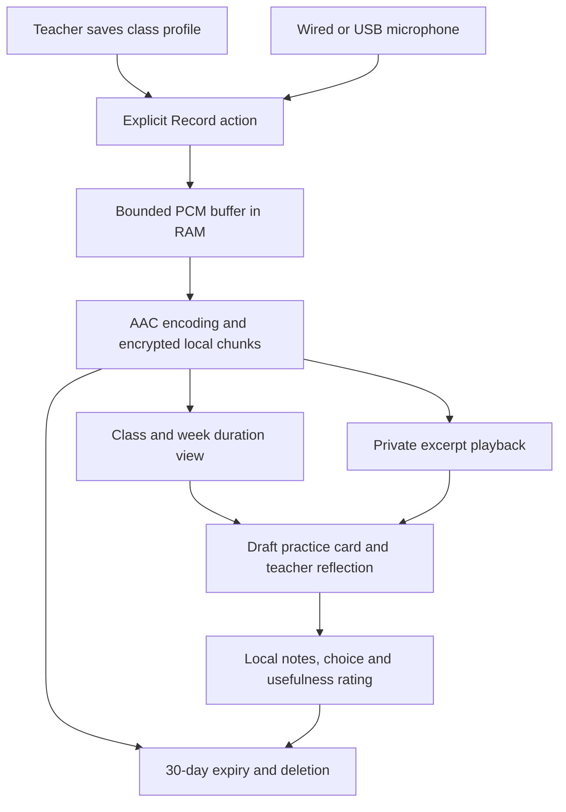

# Echo / Echovolve (ድምጽ)

Echo is an Android project for private weekly teacher reflection in Ethiopian primary classrooms. The intended experience is simple: save class details once, connect a microphone, tap Record, then Stop; review a short visual reflection and choose one practice for next week.

**Current status — 2026-10-23:** the launcher implements real offline recording and local reflection for development testing. The reflection flow now supports scoped draft cards and Grades 11–12 class profiles as a separate development pathway. Automated checks pass, but device behavior and classroom suitability have not been validated. Provider-independent Django/PostgreSQL research infrastructure supports separately scoped v1/v2 grants and an opt-in encrypted Android queue. Automatic pedagogical interpretation, reviewed secondary content and reviewed non-English content remain unimplemented; hosting and device activation still need validation. See the [implementation status](docs/PEDAGOGY_IMPLEMENTATION_STATUS.md).

## Pilot brief

| Item | Agreed scope |
|---|---|
| Participants | Eight teachers across four Hawassa primary schools, Grades 1–4, typically 40–70 pupils per class |
| Duration | One month, concurrently across the four schools, after readiness checks |
| Languages | Amharic, English, Afaan Oromo and Sidaamu Afoo intended; current local flow uses English draft UI/coaching with disclosed fallback |
| Devices | Teacher-owned Android phones, targeting 2 GB RAM and unreliable connectivity; development-team external microphones |
| Budget | 20,000 ETB for hardware only; engineering and hosting require separate resources |
| Purpose | Personalized self-reflection; no teacher ranking or pupil identification |
| Validation | Intended review by Hawassa University education specialists and the teacher education college; approval is not yet established |
| Success | More than 70% sustained adoption (at least 6/8 teachers), more than 80% positive review ratings, and interviews about teaching changes |

Grades 11–12 in the app are a separate development path. They are not participants in this agreed primary pilot, and no secondary acoustic metric or field study has been approved.

Define the rating denominator, positive-rating threshold and post-pilot follow-up interval before enrollment. Interviews establish perceived change; independent observation is needed to substantiate changed practice. See the [research and pilot assessment](docs/research/HAWASSA_PILOT_REVIEW_2026-10-10.md).

## What works today

- Saved class profiles, separate classroom/app language preferences and a Record/Stop workflow.
- Foreground microphone capture, screen-off recording support, compressed AAC chunks, encrypted local storage and interrupted-session recovery.
- Private excerpt playback, teacher context notes, lesson exclusion and deletion.
- Class/week reflection with saved-duration bars, source-linked goal-based practice cards, practice follow-up and usefulness ratings.
- Opt-in, best-effort local weekend reminders; reflection remains available on demand.
- Rolling 30-day expiry for collected lessons and reflection data. Class profiles/settings remain until separately changed.

The visual bars describe **saved recording duration**, not student understanding, teacher effectiveness or student participation. Coaching is selected from draft goal/subject-based content; it is not inferred from classroom speech. There is no ASR, teacher/student diarization or released pedagogy model.

## Current data flow



Audio is encoded at 16 kHz mono, AAC-LC 32 kbit/s, into approximately 30-second chunks, then encrypted with AES-GCM and per-file Android Keystore keys. Files are app-private and excluded from backup; no plaintext audio temporary file is created. Abrupt process termination can lose the uncommitted chunk. Playback decrypts one excerpt at a time into RAM.

The APK has microphone/foreground-service and Internet permissions, with cleartext traffic disabled. The default build has no research origin and sends nothing. A connected build binds one approved HTTPS host and supports separately authorized numeric research summaries; audio and private notes never leave the phone. Expiry is checked on reads/playback and scheduled cleanup; a powered-off or force-stopped phone cannot physically delete files until execution resumes. See [ADR-019](docs/adr/019-offline-recorded-reflection-pilot.md) for local recovery and [ADR-020](docs/adr/020-provider-independent-pilot-infrastructure.md) for research/hosting boundaries.

## Run and verify

Open `edge/android` in Android Studio. The scaffold uses Android 10+ (API 29), compile/target SDK 37 and an arm64 ABI filter. Check actual teacher device compatibility before buying accessories.

```sh
cd edge/android
./gradlew :app:testDebugUnitTest :app:assembleDebug :app:lintDebug --offline
```

Offline builds require the SDK and Gradle dependencies to be cached. If necessary, set `JAVA_HOME` to an installed JDK; Android Studio on macOS commonly provides `/Applications/Android Studio.app/Contents/jbr/Contents/Home`.

APK output: `edge/android/app/build/outputs/apk/debug/app-debug.apk`. Install using Android Studio or `./gradlew :app:installDebug` with a connected device. Follow the [offline device runbook](docs/testing/OFFLINE_PILOT_RUNBOOK.md), beginning with authorized adult test audio.

From the repository root, check the Python components:

```sh
python3 -m unittest discover -s indicators-core/python/tests -v
python3 -m unittest discover -s server/tests -v
python3 -m unittest discover -s tests/demo -v
python3 -m unittest discover -s tests/infrastructure -v
```

Recorded verification on 2026-10-11: **82 Android JVM tests, 29 research-backend PostgreSQL tests and 47 existing Python tests passed**; debug assembly and lint succeeded with existing warnings. No Android device/emulator was connected. Microphone routing, screen-off continuity, playback, Android Keystore, UI rendering and battery/memory behavior remain device-test requirements, not proven results.

## Research infrastructure

The [research service](server/pilot/README.md) implements one-time consent enrollment, individual credentials, strict summary admission, transactional withdrawal, expiry jobs, restricted aggregates and access-only backups. Follow the [non-Huawei infrastructure runbook](docs/testing/NON_HUAWEI_INFRASTRUCTURE_RUNBOOK.md) for setup and activation. No Huawei account or runtime dependency is required.

## Separate synthetic demo

Open **Settings → Open separate synthetic demo** in the Android app. It uses isolated fixture storage and a fixed demonstration date. Its measurements and sharing preferences are illustrative; it does not capture or transmit data. Microphone permission still exists in the containing APK because the main flow records real audio.

The read-only synthetic dashboard runs locally:

```sh
python3 server/api/demo_wsgi.py
```

Open `http://127.0.0.1:8000/`. This server refuses public binding and has no production authentication, intake or database. See the [synthetic demo runbook](docs/testing/DEMO_DEPLOYMENT_AND_MANUAL_TESTING.md).

## Work required before the pilot

1. Complete real-device capture, routing, interruption, retention, accessibility and resource checks on target 2 GB phones. Test microphone placement for clothing noise and student audibility.
2. Obtain educator review and appropriate school/research authorization. Finalize the pilot protocol, adoption follow-up and observation method.
3. Review and localize UI/coaching into all intended languages. Addis AI and Hasab AI are requested future integrations, not configured services; no classroom material is sent to them.
4. Validate a licensed compact on-device analysis pipeline before displaying acoustic or pedagogical metrics. Evidence gates remain fail-closed, including Grade 4; valid class metadata does not release a model.
5. Validate and activate the implemented research-summary service and Android queue against the approved Ethiopian host. Verify provider backup/WAL/log deletion and operational alerting; small-pilot summaries remain pseudonymous.
6. Verify Zergaw supports the selected Django/PostgreSQL stack before deployment, or use an approved Ethiopian VPS. Competition implementation continues in the separate [Huawei repository](https://github.com/ayimmam/Echo-Huawei-Innovation-Competition).

## Documentation

The [Innovation Competition implementation plan](docs/competition/INNOVATION_IMPLEMENTATION_PLAN.md) maps the supplied 2026–2027 Northern Africa criteria to AI, Huawei deployment, validation, reproducibility and submission work. It is a proposed delivery plan; cloud/AI integration is not implemented by that document.

Start with the [documentation index](docs/README.md), [Android guide](edge/android/README.md), [code map](docs/research/CODEBASE_STRUCTURE.md), [research assessment](docs/research/HAWASSA_PILOT_REVIEW_2026-10-10.md) and [device runbook](docs/testing/OFFLINE_PILOT_RUNBOOK.md).

[ADR-019](docs/adr/019-offline-recorded-reflection-pilot.md) defines the current offline scope. Earlier RAM-only/no-recording and Grade 2/STEM-first plans remain historical context; evidence and hosting gates still apply where compatible. The [previous architecture overview](docs/archive/ARCHITECTURE_OVERVIEW_PRE_ADR019.md) is preserved for traceability, not as a current implementation guide.
