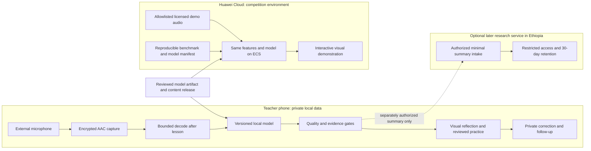

# Huawei ICT Innovation Competition implementation plan

Prepared 2026-10-11. Target: **2026–2027 Northern Africa Innovation Competition**, subject to confirmation of Ethiopia's applicable division and current organizer notices. Branch: `codex/innovation-competition-plan`, based on `version-one` at `d0582ed`.

This is an implementation plan, not a claim of eligibility, completed integration or guaranteed competition success. No cloud resources are provisioned, no project is published and no classroom data is transferred by this change. The existing local recording implementation remains the starting point.

## 1. Outcome and boundaries

Build an evidence-backed teacher reflection system with two independently demonstrable execution paths:

1. **Teacher application:** Android recording and deferred local acoustic analysis, private weekly visual reflection, educator-reviewed strategies, correction and follow-up. Classroom audio stays on its originating phone.
2. **Competition application:** an interactive application actually deployed on Huawei Cloud that runs the same versioned analysis pipeline on allowlisted, redistribution-approved public/demo audio and illustrates the teacher reflection journey. Synthetic classroom summaries are clearly distinguished from actual model outputs.

The competition entry must make an observable Huawei AI contribution, show the value of its cloud deployment, and permit judges to reproduce every submitted technical result without access to pilot records. Merely hosting screenshots or scripted indicator numbers is insufficient for the intended entry.

Preserve the agreed product brief: Grades 1–4, four schools/eight teachers in Hawassa, 40–70 pupils per classroom, Amharic/English/Afaan Oromo/Sidaamu Afoo, low-connectivity Android phones targeting 2 GB RAM, a one-month parallel pilot, and 20,000 ETB for hardware only. Do not move classroom inference to the cloud to satisfy competition presentation needs. Do not infer student understanding, teaching quality or equity from acoustic talk proportions.

The plan uses three delivery levels: a reproducible competition demonstrator, a device-validated pilot candidate, and a field-evaluated release. The first can precede the latter two; presentations must label the level actually achieved.

## 2. Rules, provenance and confirmation

The primary planning source is the supplied [Huawei Talent competition capture](../research/papers/Huawei%20Talent%20Competition%20details.pdf), inspected as four rendered pages on 2026-10-11. Page 1 identifies the 2026–2027 Northern Africa competition; pages 1–2 describe cloud/AI and open-source requirements; page 3 contains scoring/submission tables; page 4 contains participation/IP obligations. Parts of the capture are clipped by navigation/page boundaries, including some participation text. It is not sufficient to certify team eligibility.

The [live division URL](https://e.huawei.com/en/talent/#/ict/innovation-details?zoneCode=026902&zoneId=98269713&compId=85132021&divisionName=Northern%20Africa&type=C002) returned a JavaScript shell to the web reader on 2026-10-11; its current full contents were not independently verified. The [2025–2026 official manual](https://e.huawei.com/marketingcloud/pep/asset/20000001/Material/31c5d10974c24bfeb4156279db03dabc/M3T1A669N1207735409169788983/Huawei%20ICT%20Competition%202025_2026%20Manual-20251216.pdf) corroborates the general AI/project format, but does not supersede the current division's rules. The [2026–2027 Huawei announcement](https://www.huawei.com/uz/news/2026/huawei-ict-competition-2026-2027-meca-registration-launch) concerns Uzbekistan, so its local registration deadline must not be applied to Ethiopia.

Supplied capture SHA-256: `d0097a66d957c07d76e736a95e0a91b8303c3d98cb99e1950dcd39ae4e971aa7`. Preserve this evidence privately; link to the official rules in a public export rather than assuming redistribution rights for the capture.

### Scoring recorded in the supplied capture

| Criterion | Preliminary / National | Regional | Global |
|---|---:|---:|---:|
| Innovation | 60% | 40% | 40% |
| Application value | 40% | 35% | 30% |
| Completeness and demonstrability | — | 15% | 15% |
| Application and implementation progress | — | — | 10% |
| Presentation and panel assessment | — | 10% | 5% |

Source: supplied capture, page 3. Each column sums to 100%. Treat the weights as the captured planning baseline until reconfirmed. They are not internal engineering pass thresholds.

### Rule confirmation task: COMP-01, first three working days

The competition lead must obtain the latest full rules, Template 1, Template 2, submission formats/limits, exact deadlines/time zones and written answers from the organizer. Record URL, version, date, file hash and rule-to-evidence mapping. Verify student/instructor composition, enrollment status, institution restrictions, other-track participation, team-change rules and division. Do not infer eligibility from a successful login.

Ask specifically whether a fully functional Huawei cloud demonstration on licensed public audio, paired with private offline classroom processing, satisfies the topic; whether the proposed MindSpore/Huawei Cloud contribution is sufficient; what datasets must be redistributable; how reviewers receive cloud access; and how credits, regions and permitted services work. Do not send teacher or child records with the inquiry. This task belongs to the human competition lead; this plan does not send messages on their behalf.

Captured schedule: registration August–December 2026; preliminary November–December 2026; national January 2027; regional February/March 2027; global May 2027. These are windows, not verified submission dates. Use the earlier confirmed deadline if the organizer narrows a window. Reserve seven days before each deadline for artifact freeze and rehearsal.

## 3. Requirement-to-implementation matrix

| ID | Captured requirement / scoring objective | Current gap | Planned implementation and proof | Gate |
|---|---|---|---|---|
| C1 | AI application addressing a real problem | Local capture/cards exist; no model | Versioned acoustic model, measured baseline comparison, actual inference traces and model card | G2 |
| C2 | Huawei AI/ICT contribution and Huawei Cloud deployment using at least one service | No integration/deployment | MindSpore model/runtime feasibility; ECS-hosted working inference and visual application; redacted deployment evidence | G1, G3 |
| C3 | Visual interactive demonstration of core functions | Loopback synthetic dashboard only | Select approved audio, run analysis, inspect uncertainty, explore weekly reflection and choose a strategy | G3 |
| C4 | Innovation/differentiation | Narrative only | Prior-art comparison; measured benefit of abstention, codec-aware evaluation and offline workflow; ablations | G2, G5 |
| C5 | Application value, feasibility and scalability | No device or teacher evidence | Target-phone measurements, cost model, four-school pilot, teacher feedback and observation limitations | G4, G5 |
| C6 | Preliminary/National Template 1 with data processing, key code and quantitative results | No current submission | Fill current official form with linked source files, real results and disclosed limitations | G6 |
| C7 | Regional/Global code, datasets, deployment/reproduction README; reviewers rerun results | No self-contained release | Pinned dependencies, approved data/artifacts, checksums, seeds, tolerances and independent clean-machine run | G3, G6 |
| C8 | Regional/Global open-source entry and evidence | Research PDFs already tracked; no audited export | Clean allowlisted public release, explicit licenses, rights review and public repository screenshot | G6 |
| C9 | Regional/Global presentation: 15 minutes plus 5 minutes panel | No rehearsed demonstration | Timed deck, demo, video fallback, evidence appendix and Q&A | G6 |
| C10 | Fully functioning original entry with clear Huawei technology attribution and lawful rights | Device/model/cloud incomplete | End-to-end smoke tests, architecture diagram, dependency/data rights register and contribution history | G3–G6 |
| C11 | Global application/implementation progress, including community recognition | Pilot not started | Dated deployment/pilot milestones, genuine issue/contribution activity, documented improvements | G5, G6 |

C1–C3/C6–C10 are not satisfied by this document. Social value or a polished video cannot substitute for working AI, deployment or reproducibility. Stars are one example in the captured Global rubric, not a quota; do not buy or fabricate engagement.

## 4. Proposed technical architecture

There is **no phone-to-Huawei data arrow**. The optional Ethiopian service is not required to demonstrate Huawei deployment and must not delay the minimum competition demonstrator. It remains a separately tracked product requirement, not silently dropped from the full app.

### 4.1 Android: extend the current local implementation

Retain `pilot/RecordingService.kt`, encrypted chunks, recovery and retention as the capture boundary. Add an `analysis/` package under `org/ethioware/echo` with `LocalAnalysisWorker`, `AudioChunkDecoder`, `FeatureExtractor`, `AcousticModel`, `AnalysisRepository` and `EvidenceProjector` (proposed names).

- Run inference after Stop, preferably while charging, with an explicit Analyze now option. No continuous heavy model execution during teaching.
- Process one chunk/window at a time; limit CPU threads and native memory. Persist analysis checkpoints and queue status under the existing encrypted store.
- Idempotency key: lesson ID + committed-audio manifest hash + model/features/postprocessing version. A retry cannot double-count time.
- On expiry/deletion, cancel pending work, remove derived data and prevent completion from recreating deleted records. Do not extend the lesson's 30-day lifetime by re-analysis. Missing chunks remain missing observations.
- Distinguish not analyzed, analyzing, complete, insufficient audio, unsupported scope and failed analysis. Unavailable values are never zero.
- Route results through the existing provenance/release policy rather than writing model numbers directly to UI. Build an explicit adapter from the local lesson representation to evidence inputs; do not import legacy synthetic fixtures into real lessons.
- Bind any released metric to language, grade, subject, microphone conditions, codec, feature hash, model hash and postprocessing hash. Unsupported combinations remain unavailable.
- Keep the pilot APK without Internet permission until the separate research-transfer slice passes review. Ship model/content in a signed app release initially; avoid adding a remote model updater to the critical path.

### 4.2 Model scope and Huawei AI implementation

Use a two-stage acoustic scope. **Stage A:** learned speech/non-speech and recording-usability classification; useful for selecting reviewable excerpts and reporting analyzable coverage. **Stage B:** coarse adult-like/child-like/overlap-or-uncertain acoustic categories, only if independent validation supports them. These categories are not identities; adult-like speech is not automatically the teacher, and a wearable mic cannot establish all student participation.

Time-box runtime/model feasibility to five working days. Start with a compact log-mel convolutional model using a maintained, licensed MindSpore path and CPU deployment. Evaluate MindSpore Lite conversion and Android loading against the actual operator set and arm64 device. MindSpore Lite advertises Android support, but compatibility must be proven for the exact model/runtime build, not assumed from the product page. [Official MindSpore Lite overview](https://www.mindspore.cn/lite/en?version=r2.4.10).

Required spike outputs: executable desktop inference, Android inference on a small approved clip, exact version pins, conversion log, model size, peak memory, runtime and numeric agreement. Keep a simpler VAD/energy baseline and a non-quantized model for comparison. Do not commit to a runtime version until the spike passes.

If MindSpore Lite fails the phone budget, test an alternative compact runtime using the same frozen data/split. Preserve a real Huawei AI contribution through a measured MindSpore cloud model or ModelArts training/evaluation, with organizer acceptance of the alternative device runtime. ModelArts supports managed training workflows, but region, image, quota and credit availability are unresolved. [Official ModelArts training overview](https://support.huaweicloud.com/intl/en-us/develop-modelarts/develop-modelarts-0001.html). No compatibility claim or service purchase follows from this plan.

If Stage B fails, release Stage A honestly and retain teacher-led review. That is reduced product scope, not proof that automatic pedagogy analysis is complete. Reassess competition competitiveness with the instructor; never relabel VAD as student-understanding analysis. Four-language ASR, emotion inference and a phone LLM are outside the critical path.

### 4.3 Data, training and validation

Create proposed `ml/competition/` tooling with data manifests, preprocessing, training, export and evaluation commands. No model accuracy number is promised before a held-out result exists.

1. Inventory candidate corpora and pretrained weights; record license, redistribution/training rights, ages/languages, microphone geometry, consent restrictions and hashes. “Publicly downloadable” is not a license.
2. Choose data only after rights and target-label coverage pass review. Define the annotation guide and uncertainty class before training. A lack of lawful child/classroom data blocks Stage B claims; adult role-play is not child-domain validation.
3. Split by speaker and source session/room before chunking. Group all transformations of an original file in the same split. Reserve a final test set; never use it for quantization calibration, threshold tuning or practice-card selection.
4. Evaluate clean versus phone AAC round-trip audio, noise, clothing rub, microphone distance, overlap and silence. Synthetic mixtures test robustness; report separately from real recorded test sets.
5. Calibrate abstention on the development set and freeze thresholds before test evaluation. Report confusion matrices, per-class precision/recall, macro-F1, coverage versus error and aggregate-duration error with session-level uncertainty.
6. Verify FP32 versus quantized and cloud versus Android results. Store reproducible tolerances; do not require bitwise equality across different floating-point runtimes.
7. Validate target languages/grades/acoustic conditions locally where authorized, without exporting raw classroom audio. Local on-device playback/annotation and approved observer notes can support private validation. Export only reviewed aggregates; no pupil identity or voice embedding is needed.
8. Separate publicly reproducible benchmark results from private pilot evidence. Judges must be able to reproduce the former. Obtain acceptance of the latter's aggregate reporting format; do not claim private recordings are part of the supplied reproducible dataset.

### 4.4 Weekly teacher report and reviewed pedagogy

The report should take 2–10 minutes and contain: what was recorded; what evidence can/cannot support; a teacher-confirmed success; one improvement opportunity; a practical strategy for next week; and an optional correction/rating. A model must not invent “what went well” or “what went wrong.” Use explicit “you reported” versus “audio suggests” labels.

For example: a coverage bar can say “audio suitable for review,” with uncertainty. A teacher selecting “check understanding” can receive an educator-reviewed worked example: ask a question, allow thinking time, sample explanations beyond volunteers, then adapt the next example. The card must explain that the acoustic observation alone does not measure comprehension.

Move cards from hard-coded drafts into versioned content resources with: source/citation, supported age/subject, evidence strength and transfer limitations, practical steps, review owner/date and language status. Prioritize checking understanding, explicit foundational reading and eliciting explanations using the [Hawassa assessment](../research/HAWASSA_PILOT_REVIEW_2026-10-10.md). Have Hawassa education specialists validate interpretation and examples before pilot release; this is a requested review role, not an existing appointment.

Localize all four intended UI/content languages. Addis AI/Hasab AI can assist development-time translation of generic approved strings only, after confirming documented capabilities, credentials and terms. Do not send recordings, excerpts, private notes or teacher context to translation APIs. Require bilingual human review; obtain a Sidaamu Afoo reviewer instead of assuming API support. Bundle approved translations for offline use and preserve explicit draft fallback until reviewed.

### 4.5 Huawei Cloud interactive application

Create a separate `competition/` deployable package; do not publicly expose or loosen the loopback guard in `server/api/demo_wsgi.py`. Reuse tested arithmetic and schemas through explicit libraries. Proposed stack: a pinned Python API plus server-rendered responsive HTML and minimal JavaScript, served behind HTTPS on one ECS instance. Framework selection for this isolated environment does not determine Zergaw's future runtime.

The application must execute this journey:

1. Select an allowlisted audio sample with source/license and scenario explanation.
2. Run actual inference; show queued/running/completed/error state and model identity.
3. Inspect timeline, coverage, uncertainty, expected annotation and measured deviation.
4. Compare with the baseline or quantized alternative on the same sample.
5. Open a clearly labeled synthetic multi-lesson weekly view and choose/correct a strategy.
6. Inspect privacy/data-flow explanation, evidence sources and reproducibility commands.

No public audio upload, browser microphone capture, private accounts or pilot-data import in the first release. Requests accept only known sample IDs and bounded parameters; unknown IDs are rejected. Real model results must not carry synthetic measurement provenance, even if a demonstration scenario uses synthetic context. Extend provenance deliberately and test release separation before reuse of existing code.

Implement bounded inference concurrency, per-session isolation, request limits, timeouts, safe error messages, TLS, restricted admin access, process supervision, health checks, redacted logs and rollback. Keep public assets read-only; do not render real teacher/class names. Run an availability rehearsal from a network outside the deployment machine. Save redacted evidence of ECS resource/region, build ID, HTTPS URL and inference request/result correlation.

Keep a truthful Huawei contribution log: service/runtime used, code path, experiment or deployment result, and why it matters. Where Huawei tools assist development, record their actual role; do not attribute code generation or debugging to services the team did not use.

ECS is the mandatory planned cloud runtime. ModelArts/OBS are conditional for useful training/artifact workflows, not services added to inflate the architecture. RDS and Redis are unnecessary for a read-only bounded demonstrator unless measured load requires them. Obtain credits/quotes first, set expenditure alerts and a teardown date, and account for storage/IP/traffic that may continue billing after compute stops.

### 4.6 Optional Ethiopian research summary service

Track separately as a full-product milestone. Confirm Zergaw runtime, tenant isolation, TLS, database, jobs, backup/restore and deletion capabilities before implementation. Prefer one selected framework/engine rather than supporting hypothetical alternatives.

Define a minimal, versioned numeric payload without audio/transcript, free-text context, names, exact class schedules, persistent pupil IDs or embeddings. Treat stable teacher-linked summaries as pseudonymous, not anonymous. Specify authorization/withdrawal, authenticated intake, idempotent offline retries, expiry before upload, remote deletion and backup handling. If 30-day retention cannot be met across remote copies, do not enable upload. Retention remains anchored to collection, not arrival at the server.

The pilot can remain local while this service is unavailable, with the limitation declared. No competition cloud credentials or endpoints belong in the pilot app. Provide tests for wrong-destination routing and purpose separation before any future network permission is introduced.

## 5. Work packages, ownership and effort

Roles are responsibilities, not assigned people: **Lead** (competition/integration), **Android**, **ML**, **Cloud/QA**, **Education**, **Language reviewers**, and **Institutional reviewer**. A three-student team can combine engineering roles if permitted by current rules; educator/instructor review time is additional and must be scheduled. No subagents are required by this plan.

Effort is estimated person-days, not elapsed days or funded labor. Main engineering work totals approximately **89–131 person-days**, plus optional research service **10–15 days** and external reviews. Re-estimate after the first two weeks.

| Work package | Owner | Effort | Dependencies | Completion evidence |
|---|---|---:|---|---|
| COMP-01 Rules, team eligibility, templates and credits | Lead | 2–3 | None | Versioned rules register, organizer answers, exact calendar |
| COMP-02 Device/runtime/data feasibility | Android + ML | 5–8 | Initial rights screening | Actual phone benchmark and runtime decision, lawful dataset route |
| COMP-03 Model baseline, preprocessing and evaluation | ML | 12–18 | COMP-02 | Held-out benchmark, model/data cards and hashes |
| COMP-04 Deferred Android analysis and evidence adapter | Android | 10–15 | COMP-02; finalized model interface | Resumable analysis, expiry races tested, no unavailable-as-zero |
| COMP-05 Reviewed report and four-language content | Android + Education | 7–10 engineering | Draft report/metrics | Signed content review record and usability findings; reviewer effort additional |
| COMP-06 Interactive cloud application | Cloud/QA | 8–12 | COMP-03 interface | Working inference journey, separate fixture path and error states |
| COMP-07 ECS deployment and operational checks | Cloud/QA | 4–6 | COMP-01 credits; COMP-06 | HTTPS deployment, limits, smoke/load tests, rollback/teardown guide |
| COMP-08 Independent reproducibility and public export | Lead + QA | 5–8 | COMP-03/06/07 | Clean-machine rerun and allowlisted licensed release |
| COMP-09 Device acceptance and repairs | Android + QA | 8–12 | COMP-04/05 | Target-device runbook results and measured resource envelope |
| COMP-10 One-month field pilot and assessment | Lead + Education | 10–15 engineering/support | G4; school/reviewer availability | Defined adoption/usefulness/observation results, corrections and issues |
| COMP-11 Submission package and rehearsals | Lead + all | 8–14 | Stage-appropriate gates | Official templates, demo/video, evidence appendix and frozen tag |
| COMP-12 Optional research transfer | Cloud + Android | 10–15 | Provider/authorization/retention evidence | End-to-end consent, retry, deletion and purpose-separation tests |

Reviewable implementation PR sequence: (1) manifests/contracts, (2) model/runtime spike, (3) benchmark and artifact, (4) local worker/storage integration, (5) report/localization, (6) cloud demo, (7) deployment/reproduction, (8) acceptance fixes, (9) pilot evidence, (10) submission export. Each PR names linked C-requirements and gate evidence. Only planning files are changed on this branch now; later implementation should use focused branches from the agreed baseline.

## 6. Delivery calendar and critical path

Proposed start: 2026-10-12. Assumes two to three engineering contributors and timely external reviews. A single developer should budget roughly 18–27 working weeks for the main scope at these estimates; do not promise the calendar below without staffing. Pilot enrollment and university review are external dependencies, not tasks code can complete automatically.

| Window | Deliverable / exit |
|---|---|
| Oct 12–18 (W1) | Rule/registration/template confirmation, target-device inventory, rights register, small runtime smoke test; G0 |
| Oct 19–25 (W2) | Runtime/data feasibility decision, baseline and model interface, initial report review; G1 |
| Oct 26–Nov 8 (W3–4) | Train/evaluate baseline model; implement local worker and cloud inference journey; draft educator-reviewed cards |
| Nov 9–22 (W5–6) | Measured AI demonstrator on Huawei ECS, clean-machine reproduction, preliminary Template 1; G2/G3 for scoped demo |
| Nov 23–Dec 6 (W7–8) | Device repairs, approved language packs and institution/school readiness; freeze pilot candidate only if G4 passes |
| Dec 7–Jan 5 (30 days, provisional) | All four schools run concurrently; weekly support and reviews, final interviews/observations; G5 evidence |
| Jan 6 onward | National submission update and continued-use follow-up; exact national deadline overrides this schedule |
| Feb–Mar 2027 window | Regional package, independently reproduced release, public-source evidence and 15+5 rehearsal |
| May 2027 window | Global update with actual implementation progress, remaining errors and community contributions |

The illustrative post-pilot adoption follow-up is Jan 19, two weeks after completion; confirm it with teachers. If a January submission precedes this, report it as pending. If readiness slips, move all four schools' pilot together; do not shorten the promised month or claim future results. Preliminary material may report bench/device results and clearly mark the pilot as planned.

Critical path: **rules/credits + lawful data → Huawei-compatible model spike → held-out results → cloud inference + phone integration → device/content/institutional readiness → 30-day pilot → field evidence**. Start the reproducibility/export work early; it is not a final-week documentation chore. COMP-12 is outside the competition critical path unless organizer requirements change.

## 7. Gates and measurable acceptance

Numeric engineering thresholds below are **proposed internal targets**, not Huawei scoring requirements or validated promises. Freeze final thresholds with the responsible reviewers before the held-out evaluation. Failed gates narrow scope or delay release; they never authorize substituting fixture output.

| Gate | Required evidence | Proposed pass condition / failure action |
|---|---|---|
| G0: rules and resources | Complete current division rules, team eligibility, exact deadlines, credits/quote and rights owner | No unresolved mandatory-rule conflict; otherwise continue reversible development but do not claim eligibility |
| G1: feasibility | Exact runtime/model on actual 2 GB phone; data/license pathway | Compact model loads, short inference succeeds, reproducible export; failed path triggers five-day alternative-runtime spike |
| G2: AI validity | Speaker/session-disjoint test, baseline comparison, per-class errors, abstention, codec/quantization checks | Stage A proposed macro-F1 ≥0.85 on declared test domain; Stage B proposed macro-F1 ≥0.75 and adult/child duration MAE ≤10 percentage points at ≥70% declared usable coverage; report CIs and subgroup coverage. Domain evidence is required separately; aggregate success never releases unsupported languages/grades |
| G3: cloud/reproduction | Actual Huawei service, working visual inference, frozen assets, independent rerun | All curated demo cases and malformed-input/error tests pass; five concurrent curated runs have no leakage/crash, proposed p95 response ≤30s for a 30s clip; deployment/model identity matches submission; measured tolerances reproduced |
| G4: pilot readiness | Device runbook, content/translation approval, mic fit, institutional/school decisions | All safety/data-loss acceptance rows pass; proposed capture overhead ≤5 battery percentage points/hour vs idle, capture PSS <200 MB, total analysis PSS <350 MB, real-time factor ≤0.5 on target phone; no thermal warning in prescribed run. Teacher can complete Record/Stop unaided and read report in 2–10 min |
| G5: application value | One-month pilot, defined denominators, non-coercive ratings, interviews/observations | Report actual counts and uncertainty; target ≥6/8 continued users and >80% positive reviews. Failure leads to a documented iteration, not removal of dissatisfied participants |
| G6: submission | Correct templates, public release audit, current URL, exact code/model/data hashes, rehearsed presentation | Another person reproduces stated results; no confidential or unlicensed artifacts; uploads and receipt verified by authorized team member before deadline |

Measure capture and analysis separately, including thermal/battery baselines, charging status and concurrent processes. Test minimum supported Android version and at least two actual low-memory teacher-device/mic configurations. Include phone calls, screen lock, route loss, permissions, low storage, process death, reboot, clock changes, corrupted keys, deletion during inference and expiry during retry. Use the existing [offline runbook](../testing/OFFLINE_PILOT_RUNBOOK.md) as the base.

For G2, an educator/ML reviewer must assess whether the sample size and confidence intervals support release. Public-corpus performance alone cannot validate Ethiopian classrooms. Do not retain or upload personal data beyond the agreed month to obtain a larger benchmark.

## 8. Pilot and impact protocol

Recruit eight teachers from four schools and record supported language/grade/subject coverage without pretending this spans every combination. Obtain baseline teaching context and a short observation protocol before use. Keep support voluntary; research withdrawal must not affect employment or classroom participation.

- **Usage:** define an active week as at least one saved lesson and one opened reflection, unless the study team agrees a different teaching schedule before enrollment. Report active teacher-weeks out of all eligible teacher-weeks, not only completers.
- **Adoption:** more than 70% of eight means at least six teachers. Measure week-four use and separately continued use at the agreed two-week follow-up; do not rename pilot completion as post-pilot retention.
- **Usefulness:** positive = 4 or 5 on a five-point rating, proposed for protocol approval. Report positive/submitted reviews, response rate and per-teacher distribution. There are at most 32 scheduled teacher-week reviews over four review cycles; missing ratings are not positive. If all 32 respond, at least 26 positive exceeds 80%.
- **Teaching changes:** pre/post interviews plus a small, predefined observation rubric for checks for understanding, explanation opportunities and chosen practice use. Double-code a feasible subset and report agreement. This feasibility sample cannot establish causal student-learning improvement.
- **Burden/failures:** time to start/stop, review duration, unusable audio, recording loss, correction frequency, battery impact and support visits. A high correction rate is evidence to improve calibration, not to suppress corrections.
- **Retention:** summarize approved aggregate evidence before local source expiry. The app must still delete data on schedule. Retaining separately collected identifiable study records beyond one month requires a separately agreed protocol; it is not assumed here. Publish only disclosure-reviewed anonymous results; avoid school/language cells that reveal a teacher.

App-rated use can be reviewed on the phone during support visits while research sync is unavailable. Do not take identifiable screenshots or export notes as a workaround. Keep public technical reproducibility independent of private field evidence.

## 9. Reproducibility, open source and deliverables

Proposed paths below are work outputs, **not existing commands or implemented files**:

| Proposed artifact | Required contents |
|---|---|
| `competition/README.md` | Local run, cloud deploy, model/data acquisition, resource needs, expected outputs, limitations and teardown |
| `competition/manifests/` | Release, dataset, model and feature hashes; source licenses; environment locks; seeds and tolerances |
| `ml/competition/` | Preprocess/train/export/evaluate scripts and frozen split definitions |
| `competition/web/` | Interactive demo with actual inference and clearly separated illustrative reports |
| `infra/huawei-cloud/ecs/` | Deployment template/script, example config without secrets, TLS/health/rollback/cost instructions |
| `tests/competition/` | Inference/provenance, isolation, forbidden-input, regression and reproduction checks |
| `docs/competition/evidence/` | Sanitized benchmark, device, deployment and pilot result summaries, indexed by C1–C11 |
| `tools/release/export_competition.py` | Allowlisted public export plus rejection of prohibited files and missing licenses |

Define a single documented benchmark command during implementation and run it on a fresh environment. Pin dependency versions/container digest, model checksum and dataset checksums. Reproduction should need ordinary CPU access for the small demo inference; expensive retraining is separately documented with its own costs and expected tolerance. Provide a no-cloud local rerun plus cloud deployment steps; local reproducibility does not replace the required Huawei URL.

**Publication risk already present:** `docs/research/papers/` contains tracked supplied PDFs. Adding `.gitignore` or deleting files in a new commit does not remove them from Git history. Prepare a fresh allowlisted public release repository or another explicitly reviewed clean-history strategy. Scan full exported history and artifacts for papers, personal data, credentials, recordings, APK signing keys and provider configs before publication. Do not rewrite or publish the current repository as part of planning.

Choose the team's code license after ownership approval (Apache-2.0 is a candidate, not assumed permission); retain dependency/data/model notices and distinguish non-code terms. Judges' required dataset access must be compatible with redistribution and the competition's reuse rights. Replace incompatible data rather than including it without permission. Link to publications instead of copying their PDFs.

### Stage packages

- **Preliminary/National:** latest Template 1 Word document; problem/beneficiary evidence; innovation comparison; dataset selection/processing; named key code; quantitative achieved results with limitations; architecture showing Huawei's exact role; supplemental demo/video as permitted. Do not replace the official template with this Markdown plan.
- **Regional:** latest Template 2 deck; working Huawei visual demo URL; complete reviewed source and approved dataset/model access; deployment/reproduction README; public-repository evidence; test results that match the submitted build.
- **Global:** refreshed Regional package plus actual application/deployment progress and genuine open-source uptake. Maintain matching hashes and frozen result versions after each correction.

Prepare a 15-minute presentation and five-minute Q&A according to the supplied capture: 2 minutes problem, 3 architecture/innovation, 5 live demo, 3 measurements/application value, 2 deployment/limitations/next steps. Video fallback uses only approved demonstration assets and is labeled recorded; it cannot replace a working cloud submission where required. Rehearse skeptical questions about student audibility, language generalization, privacy, Huawei contribution, costs and reproducibility.

## 10. Budget, risks and scope control

The 20,000 ETB hardware budget stays ring-fenced. Illustrative procurement **caps, not market quotes**: eight mic/adapter sets at 1,750 ETB = 14,000; two spare sets at 1,750 = 3,500; compatibility/transport contingency 2,500; total 20,000. Test one complete set on actual phones before batch purchase. If quotes exceed the cap, adjust quantities/specifications with the team rather than borrowing from unbudgeted hosting funds.

Engineering, educator/translation review, school visits and hosting are additional resources. Obtain a Huawei estimate covering ECS hours, region, CPU/memory, disk, public IP, traffic, model storage and any optional training. Record voucher amount, eligibility, expiration and overage behavior. Set a team-approved spending ceiling before provisioning; zero funding means deployment remains blocked. Local development can continue, but a local demo does not fulfill the cloud requirement.

| Risk | Trigger | Response / owner |
|---|---|---|
| Rule interpretation differs or dates move | Organizer response/current notice | Update matrix/calendar immediately; Lead; never weaken privacy promises to fit a deadline |
| No licensed reproducible acoustic data | Rights/scope audit fails | Use a narrower lawful benchmark; delay Stage B; ML + Lead |
| Wearable mic misses pupils | Distance/noise validation | Validate placement/adapter; suppress student-related claims; Android + Education |
| Model inaccurate on target conditions | G2 failure or large subgroup gap | Abstain, narrow release scope, collect only authorized local validation; ML |
| MindSpore artifact fails device constraints | G1 operator/memory/runtime failure | Time-box alternative runtime with real Huawei AI contribution; confirm acceptability; ML |
| Credits unavailable or costs exceed ceiling | Quote/voucher check | Smaller bounded ECS demo, local training where valid, funding decision; Cloud + Lead |
| Translation/educator review delayed | Reviewer unavailable | Keep explicit draft languages out of field release; move pilot rather than mislabel review; Education |
| Pilot starts too late | G4 not complete by Dec 6 | Submit technical evidence only; move full 30-day pilot and disclose pending results; Lead |
| Current repository leaks papers/secrets | Public export audit | Block publication; fresh allowlisted export with full-history inspection; QA |
| Demo passes but impact targets fail | G5 findings | Show actual outcomes, corrections and iteration; do not claim improved learning; Education |
| Zergaw cannot meet retention/security | Provider evidence fails | Keep research transfer disabled; preserve independent competition demo; Cloud |

## 11. First ten working days and definition of done

Days 1–3: confirm division/rules/templates/team, assign owners, inventory phones/mics, request credits, finalize data rights screening and pilot review contacts. Save decisions; do not mark unreturned requests complete.

Days 4–5: run compact model in MindSpore/Android on an approved sample; record actual costs and constraints; draft report cards with evidence caveats; create the immutable model/data interface.

Days 6–8: compare baseline/model on an initial held-out set, implement chunk decoder/analysis checkpoint skeleton, build a local interactive inference page and validate no private data path.

Days 9–10: review G1 evidence, select exact runtime, freeze the next four-week backlog, set measured G2 thresholds with reviewers and approve the funded deployment design. If feasibility fails, revise scope before building polish around unreliable output.

The intended final entry is done only when every applicable mandatory rule has evidence, the submitted AI/cloud application runs, an independent reviewer reproduces the results, the public package has clear rights, the presentation matches the exact release, and the authorized team completes submission. Product completion additionally requires device/educator/language readiness and the agreed pilot evidence. The organizer retains eligibility and scoring decisions.
