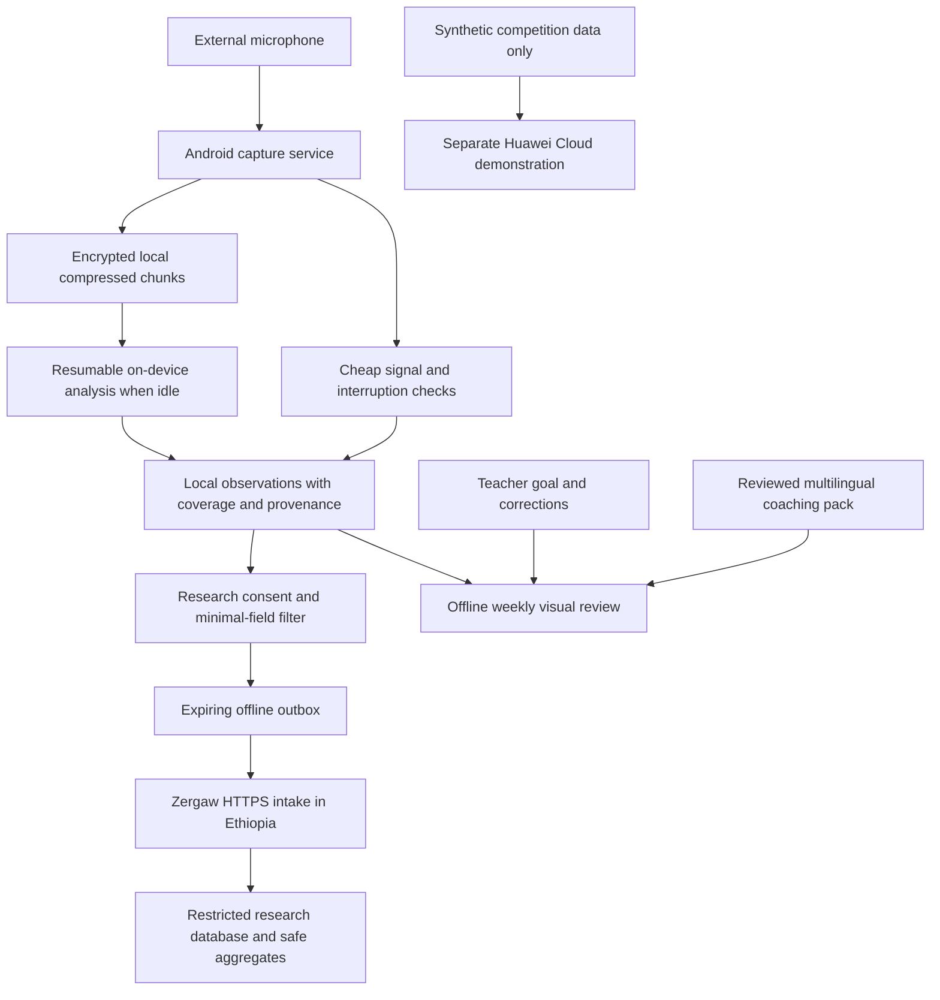

# Echo: Hawassa pilot architecture and pedagogy review

> **Implementation follow-through, 2026-10-11:** This is the dated assessment that informed [ADR-019](../adr/019-offline-recorded-reflection-pilot.md). Local recording, encrypted storage, recovery, expiry, excerpts, duration views, draft coaching and reminders have since been implemented. Its identified gaps are assessment-time findings; use the [current code map](CODEBASE_STRUCTURE.md) and [runbook](../testing/OFFLINE_PILOT_RUNBOOK.md) for what is built and tested. Device/model/translation/institutional validation and research transfer remain pending.

Review date: 10 October 2026. Scope: assessment and proposed design, not implementation approval or evidence of field readiness.

## Recommendation

Proceed with a staged, offline-first teacher-reflection pilot. Keep the Android shell, deterministic indicator contract, measurement provenance, and honest unavailable states. Build reliable capture and a small, reviewed coaching library before expanding acoustic inference. A polished report is feasible without an on-device large language model. Reliable judgments about questioning, feedback quality, or student understanding are not established by this repository or by speech-duration metrics.

The product should connect **an observation → teacher interpretation → one teaching experiment → next-week reflection**. It should not score teachers or describe undetected student voices as non-participation.

## Current brief and conflicts with older plans

The current user brief is authoritative: Grades 1–4; Amharic, English, Afaan Oromo and Sidaamu Afoo; 40–70 pupils; four Hawassa schools and eight teachers; Android phones with 2 GB RAM; a supplied external mic; offline local audio and analysis; optional/authorized research summary transfer to Ethiopian hosting; one-month app-data retention; private weekly coaching lasting 2–10 minutes; 20,000 ETB hardware budget; Huawei competition integration.

Older ADRs and research documents describe RAM-only/no-recording capture, Grade 2 reading, an undergraduate STEM trial, two cloud-sharing purposes, and longer proposed research retention. These are historical design decisions, not authorization to override this brief. Before coding, replace conflicting contracts with one explicit revision. Do not silently preserve private-summary cloud sync when the current requirement only needs research summaries. Suggested retention interpretation pending confirmation: a rolling 30-day maximum for collected audio, summaries, corrections, queued transfers, server records and recoverable copies; ordinary app configuration and nonpersonal coaching content are separate.

The user confirmed a one-month pilot running in parallel across all four schools. The 20,000 ETB is for hardware only. Hosting, engineering, translation, validation and fieldwork need separate funding estimates; their budgets are not established by this hardware allocation.

## Repository findings

| Priority | Verified finding | Consequence and recommended action |
|---|---|---|
| P0 | `edge/android/app/src/main/AndroidManifest.xml` has no microphone permission or recording service. `MockMeasure.kt` supplies synthetic observations. | Capture, screen-off operation, audio routing, recovery and local analysis all need implementation. Do not field-deploy this build. |
| P0 | `domain/MetricEvidence.kt` has an empty model-release registry. | Correct safeguard: no real acoustic metric is currently validated or released. Keep this boundary; never mark a model released just to populate charts. |
| P0 | `data/Storage.kt` stores synthetic state in plain SharedPreferences. | Add authenticated encrypted audio files and encrypted structured storage with Keystore-managed keys. Implement expiry, deletion and exclusion before real capture. |
| P0 | The existing server is a read-only synthetic WSGI demo. Production identity, grants, intake, deduplication and deletion are absent. | The diagram is a demo code map, not a deployed end-to-end infrastructure. A real research endpoint is a later, separate increment. |
| P1 | `MetricEvidence.kt:126–129` recognizes O/1/2/3 as early grades, not Grade 4. | Add Grade 4 to the contract and matching Python policy only with explicit scope and evidence. Adding the enum alone does not validate it. |
| P1 | `data/Models.kt` has EN, AM and SID, no Afaan Oromo; Sidaamu content falls back to English. | Complete four reviewed language packs. An app-language setting is distinct from classroom language and from model validation coverage. |
| P1 | `Rules.kt` offers cards by excluding dismissed cards; it does not personalize from a pedagogical diagnosis. `ReportScreen.kt` primarily presents I1/I5 as numbers. | Add goal, lesson context, teacher confirmation, a visual evidence view and an explainable card-selection rule. Preserve the ability to choose another strategy. |
| P1 | `app/build.gradle.kts` sets minSdk 29 and arm64 ABI filtering. | Inventory actual phones before promising compatibility; 2 GB RAM does not establish Android version or 64-bit OS support. Benchmark release builds and native-library compatibility. |
| P1 | Current app docs acknowledge process-death recovery is absent. No automatic 30-day purge was found in the inspected state/storage path. | Persist capture checkpoints, mark interrupted intervals missing, and expire data independently of whether the weekly report is opened. |

Useful existing work: Today/Reflection/Settings navigation, optional lesson exclusion, follow-up cards, provenance checks, synthetic/real separation, independent metric eligibility, and Kotlin/Python contract fixtures. Preserve these rather than rewriting the app.

Validation performed: 9 indicator tests, 18 server-demo tests, 7 mock-data tests and 10 hosting-readiness tests passed (44 total). These are Python tests. No Android build, physical-device battery test, microphone test, model benchmark or real-provider deployment was performed in this review.

## What the research supports

This was a targeted review of the repository research pack and selected primary studies, updated with sources available on the review date; it is not an exhaustive systematic review. Older evidence remains useful when its setting and limitations are explicit.

The locally supplied **Yisihak & Damtew (2024)** study is unusually relevant: 30 analyzed English teachers in five Hawassa public primary schools, using 2021/22 data. It reports a mean knowledge-test score of 43.4%, with 70% below 50%. This identifies a local reading-instruction preparation concern, not a national prevalence estimate, an audio-detectable deficit, or a current diagnosis of the pilot teachers. See the supplied paper, methods pp. 5–6 and findings/limitations, [DOI](https://doi.org/10.1155/2024/5596229).

**Haile & Mendisu (2023)** studied Grade 1 Koorete instruction in Amaro with 30 teachers and school sampling, observations, interviews and questionnaires. It identifies weaknesses in phonological-awareness knowledge and practice alongside materials and training constraints. It supports explicit instruction and practical teacher support, but cannot rank deficits across all four target languages. [DOI](https://doi.org/10.1155/2023/9527369).

The broader **MTTCA 2019 report, revised 2020**, assesses language knowledge and pedagogy across seven languages and emphasizes both teacher competency and home/school resources. It does not establish teacher behavior as the sole cause of low attainment. [AIR report](https://www.air.org/sites/default/files/2025-09/Mother-Tongue-Teachers-Competencies-Assessment-Final-Report-June-2020.pdf).

The **2025 GEEAP literacy synthesis**, summarized by its publishing partners, supports explicit, systematic instruction covering decoding and language comprehension, adapted to language characteristics and accompanied by materials and teacher support. Echo should complement curriculum resources, not substitute an acoustic score for them. [World Bank/GEEAP summary](https://www.worldbank.org/en/news/press-release/2025/10/30/new-report-offers-evidence-based-solutions-to-address-global-literacy-crisis-among-children). The full report download was inaccessible during this review; the publisher summary was read. [2023 GEEAP synthesis](https://www.worldbank.org/en/news/feature/2023/06/21/evidence-based-cost-effective-learning-education-improvements) also supports structured pedagogy as a package.

A randomized study of 224 Utah mathematics/science teachers reports 20% more focusing questions with automated feedback, but no effects on other practices. Its language, grades, infrastructure and semantic-analysis pipeline differ from Echo. It supports testing specific actionable feedback, not claiming Ethiopian learning gains or that an acoustic-only model recognizes question quality. [Author-hosted manuscript](https://mqicoaching.cepr.harvard.edu/sites/g/files/omnuum3591/files/2026-01/Automated%20Feedback%20Improves%20Teachers%E2%80%99%20Questioning%20Quality%20in%20Brick%20and%20Mortar%20Classrooms_Opportunities%20for%20Further%20Enhancement.pdf).

### Recommended coaching priorities

The ordering below is a design judgment combining local need, broader intervention evidence, classroom practicality and measurability—not a measured Ethiopian ranking of effect sizes.

| Priority | Teaching mechanism | Practical next-week experiment | Evidence Echo can honestly use |
|---|---|---|---|
| 1 | Check understanding and respond to errors | After one worked example, ask children to try a fresh item; sample answers from different parts of the room; address the error and check again. | Teacher reflection and sampled observer evidence. Sound alone cannot identify correct answers or instructional adaptation. |
| 2 | Explicit early literacy instruction | Use a curriculum-aligned sequence: model a sound/symbol or word skill, practice together, then check an individual application. | Subject/grade goal and teacher-confirmed practice. Local language experts must adapt examples and orthography. |
| 3 | Elicit explanations and extend answers | Ask “How did you know?” or “Which part of the story helped you?”; build on the response. | Teacher-confirmed examples or human observation. Automatic semantic labels remain deferred. |
| 4 | Give thinking and speaking opportunities | Ask, allow an appropriate thinking pause, use a brief partner response, then invite explanations. | Validated turn timing may support reflection; silence is not automatically thinking time and is not question-specific wait time. |
| 5 | Give specific, usable feedback | Name the successful step, identify one next step, and let the child retry. | Teacher report/observer assessment. Neither praise count nor teacher-talk percentage establishes feedback quality. |

EEF's [feedback guidance](https://educationendowmentfoundation.org.uk/education-evidence/guidance-reports/feedback) and [oral-language synthesis](https://educationendowmentfoundation.org.uk/education-evidence/teaching-learning-toolkit/oral-language-interventions) are supporting sources, with limited direct transfer to Hawassa. Do not display their average effect sizes as promised gains for Echo.

Keep I1 (adult share of observed speech) and I5 (adult/child alternations per observed minute) descriptive and conditional on local validation. Do not prescribe a universal ideal talk ratio, penalize teacher modeling, classify choral response as inherently bad, infer participation equity, identify individual children, or equate more alternations with better learning. The repo's DART follow-up already distinguishes acoustic classification from pedagogical validity.

## Proposed infrastructure

**Android:** retain Kotlin/Compose. Add a capture service, audio repository, analysis worker, report builder and research outbox behind interfaces. Split the current ViewModel as these responsibilities arrive; do not introduce microservices or an elaborate dependency graph.

Start microphone capture while the app is visible, with runtime permission and the appropriate microphone foreground-service declaration/notification. Continue with the screen locked; expose Stop in the notification. WorkManager is for deferred analysis/sync, not the live recorder. See [Android foreground-service requirements](https://developer.android.com/develop/background-work/services/fgs/service-types).

Use a bounded PCM buffer and short, recoverable compressed chunks, encrypted before durable storage. Avoid an hour-long raw file followed by a mandatory second compression pass. Candidate encoding: mono Opus at 24–32 kbit/s; test AAC-LC as the device-compatible alternative. Android lists Opus encoding from Android 10, matching the current minimum SDK, but codec/container/encryption integration still needs tests on each phone. [Android formats](https://developer.android.com/media/platform/supported-formats).

At 24–32 kbit/s, nominal payload is 10.8–14.4 MB/hour, or 324–432 MB for 30 one-hour sessions, before overhead. At 16 kHz/16-bit mono, PCM is 115.2 MB/hour. These are arithmetic estimates, not measured app sizes or a guarantee that compression preserves child-speech classification. Evaluate the exact compressed/decompressed path used in production.

Start with inexpensive clipping/no-signal checks during capture and deferred inference. Use a small licensed model with bounded windows and a single measured CPU configuration; compare a supported MindSpore Lite build with LiteRT or ONNX Runtime Mobile only through an initial benchmark, then ship one runtime. Large ASR/diarization/LLM stacks across four languages are outside the demonstrated feasibility of this 2 GB/budget envelope. Do not promise reliable automatic coaching from semantics in the first pilot.

Analysis should checkpoint and pause on heat or low battery. Prefer idle/charging, but provide “finish analysis” outside class and assemble available reports on opening the app; charging-only processing could leave some teachers without reviews. Weekend reminders are best-effort local notifications, never a network or exact-alarm dependency. Report pending and unavailable lessons explicitly.

**Research server:** tiny authenticated HTTPS ingestion plus a transactional database and scheduled expiry is sufficient for eight teachers. Validate schema/size, purpose authorization and an idempotency key; acknowledge only after commit; retry with backoff; drop expired queued records rather than uploading them late. No GPU, transcription, Celery/Redis or public teacher dashboard is needed. Keep local reports independent of server success.

[Zergaw's current page](https://zergaw.com/shared-hosting-platform/) advertises Ethiopian hosting, Python, SSL/SSH and weekly backups. It does not establish managed WSGI/ASGI, database versions, reliable cron, tenant isolation, all backup locations or deletion support. Preserve the existing capability gate. Prefer one Django/WSGI deployment if supported; use FastAPI only if managed ASGI is actually available. Obtain a written quote and perform synthetic deployment, restore and expiry tests first.

**Huawei:** host the synthetic demonstration on a Huawei service and document its real contribution. Do not send pilot audio, transcripts, embeddings or teacher-linked records to that environment. Use MindSpore Lite only if the exact artifact meets device constraints. The repo records a Huawei deployment requirement, but this review did not independently verify the applicable 2026–27 regional rulebook or acceptance of a synthetic-only cloud tier; confirm that with the organizer before presenting compliance. Free credits and model licensing also remain unconfirmed.

## Classroom interaction and microphone feasibility

Set up the class profile once: grade, subject, classroom language(s), approximate class size, device/mic route and a teacher-selected learning goal. Keep profile switching easy for teachers with multiple classes. Changing app language must not overwrite classroom language.

Before class: connect mic, select the remembered class and tap Record. A brief automatic route/signal check should run without a mandatory 30-second wizard every lesson. Never silently fall back to a different microphone after unplugging. During class: screen off, no scoring, no prompts. After class: Stop saves locally automatically with an accessible discard option; context correction is optional and can wait until the weekend.

A mic under clothing can produce rubbing and muffling. Test that exact setup against an unobtrusive collar placement. Prefer a compatible wired lavalier where practical to avoid another battery/pairing workflow; adapters and connectors need physical checks. A close teacher mic does not guarantee room-wide child audibility. Test front/back/side positions, quiet speakers, overlapping voices and ordinary classroom noise. If children are not reliably audible, suppress the ratio/alternation measures and offer teacher-led reflection instead.

Suggested engineering acceptance targets, to be ratified with actual devices: start/stop within two taps after profile setup; no required classroom interaction; 60-minute screen-off capture without silent data loss; app PSS under 200 MB during capture; incremental battery drain no more than 5 percentage points per hour relative to a matched screen-off baseline; post-processing of an hour in at most 15 minutes without thermal warnings; no temporary full-lesson PCM files. These are proposed targets, not achieved results. Test calls, unplugging, Bluetooth route changes, low storage, permission revocation, process kill, reboot and clock changes. Treat every capture gap as missing evidence.

## Teacher report and content pipeline

Keep three destinations: Today, Reflection, Settings. The weekly report should open offline and provide a two-minute path, with optional detail up to ten minutes:

1. What is covered: lessons, usable recording coverage and limits; no teacher-quality score.
2. One strength supported by evidence or explicitly labeled teacher report. Never invent praise from a ratio.
3. One uncertainty or opportunity, stated as a question the teacher can correct.
4. One visual action sequence tied to the selected goal, with an age/subject-appropriate example.
5. Choose it for next week, change it, or dismiss it. Next week ask whether it was tried and useful.

An uncertain recording still yields a practical reviewed strategy, clearly labeled as goal-based rather than an audio finding. Corrections update interpretation or eligibility; they do not overwrite original measurements or automatically become model-training truth. Free-text context stays local.

Use Addis AI and Hasab AI during content preparation to draft translations of nonpersonal coaching templates. Review with fluent teachers and Hawassa education specialists, then bundle versioned packs. [Addis documentation](https://docs.addisassistant.com/docs/capabilities/translation) lists Amharic, Afaan Oromo and English; [Hasab documentation](https://developer.hasab.ai/supported-languages) lists those plus Tigrigna, with Oromo marked beta. Neither page lists Sidaamu Afoo. Obtain human Sidaamu translation; do not disguise an English fallback as completed localization. API marketing claims are not validation of pedagogical wording. No runtime translation of private recordings, transcripts or teacher notes is needed, and no API key belongs in the APK.

Each card should record its source, target skill, appropriate grade/subject/language, evidence limitations, reviewer, review date and content version. Hawassa partners should review curriculum fit and comprehensibility, and independently compare model observations with human judgments. Revisit the literature periodically during content releases; teachers should not receive unreviewed, dynamically generated advice.

## Privacy and research usefulness

Local audio still includes children's personal data. Establish the applicable institutional ethics, school/guardian information and consent procedures, controller responsibilities and local legal review before field capture. The Ministry publishes the [Personal Data Protection Proclamation](https://justice.gov.et/en/law/personal-data-protection-proclamation/); this review is not a determination that device-only storage satisfies every obligation.

Do not call individual longitudinal records anonymous merely because names are removed. With eight teachers, school/language/grade/timing combinations can identify people. Treat linkable research records as restricted pseudonymous data; if the requirement is truly anonymous transfer, send only appropriately pooled outputs and accept reduced longitudinal analysis. No school-level teacher comparisons when each school has two participants. A minimum contributor threshold alone does not guarantee anonymity.

Minimize the research payload to consented, necessary counters, coarse period, measurement/content version, eligibility reasons and bounded summary statistics. Exclude audio, transcript fragments, voiceprints/embeddings, exact lesson times, names, precise locations and free-text notes. Keep enrollment identity mapping separate where linkage is necessary. Restrict developer access by purpose, log access without copying payloads, and do not expose unrestricted CSV dumps. Summary-only research can improve usability and evaluate indicators; it cannot substitute for labeled audio needed to train a new acoustic model.

Implement 30-day expiry at creation time across audio, derived data, corrections, outbox, server and backups. Restores must reapply expiry and withdrawal before serving data; restoring a backup must not resurrect old records. Purge on app opening as well as scheduled work. Android cannot execute deletion while a phone is powered off or the app is force-stopped: disclose that physical deletion occurs on the next allowed execution, deny expired access immediately on reopening, and have the institution approve this limitation. Keep keys per recording where feasible to support deletion, without promising forensic erasure of flash storage. Do not retain research data for years under the older draft without a new agreed policy.

## Budget and staged pilot

The 20,000 ETB allocation is for hardware only. Buy only after testing a sample with the actual teachers’ phones. An illustrative allocation, not supplier prices or a recommendation to spend the full amount:

| Hardware allowance | ETB |
|---|---:|
| Eight microphone kits plus two spares | 12,000 |
| Compatible adapters, cable clips and strain relief | 2,000 |
| Shared charging/power accessories where phone checks show a need | 4,000 |
| Replacement/compatibility contingency | 2,000 |
| Total ceiling | 20,000 |

Obtain local quotes and reallocate after the compatibility test. Do not buy eight identical kits before checking TRRS/USB-C routes and actual noise performance. No extra phones are included; if existing phones fail compatibility, revisit the allocation.

Hosting, engineering, field visits, translation and university validation are outside this hardware budget and remain uncosted. [Zergaw’s page](https://zergaw.com/shared-hosting-platform/) advertises Basic hosting at 5,481 ETB/year but also says pricing is being updated; this is a separate provisional operating expense, pending quote/tax and capability checks. Huawei credit availability is unconfirmed. Hardware funding does not establish the engineering capacity to deliver a validated four-language speech system.

Suggested delivery gates:

1. **Scope and feasibility:** reconcile contracts; inventory all eight phones; test two mic placements; agree curriculum focus, approvals and expiry; verify hosting. Start with one lesson family (early literacy is best supported by the supplied research), while retaining the four-language/Grades 1–4 product goal.
2. **Local vertical slice:** reliable record/stop, encrypted local storage, recovery, expiry, reviewed coaching and corrections. Fully useful offline, even with no released model metric.
3. **Measurement validation:** observers independently annotate approved sampled lessons, on the device where audio is reviewed, without exporting audio. Separate acoustic accuracy, pedagogical interpretation and teacher comprehension. Hold out teachers/schools, not random adjacent audio windows; report error and coverage by device, language, grade and mic position. Eight teachers cannot validate all language × grade combinations. Keep unsupported combinations unavailable.
4. **Field pilot:** run all four schools concurrently for one month after readiness: week 1 onboarding/baseline, weeks 2–3 coached use, week 4 continued use and endline observation/interviews. Generate a reflection each weekend, labeling baseline separately; the first week can offer goal-setting without claiming measured improvement. University partners collect independent before/after observations alongside interviews. If held-out accuracy is inadequate, continue a transparent reflection-only pilot and do not claim the automated-measurement goal succeeded.
5. **Research transfer and competition demonstration:** enable only after consent, provider, retention and security checks; maintain the synthetic Huawei environment separately.

Define success before enrollment. More than 70% of eight teachers means at least **6 of 8**, counted against all enrolled teachers. Proposed sustained-use definition: use the recording/reflection workflow in each of the first two weeks after the one-month pilot, without researcher prompting; record reasons for nonuse and missing connectivity. This is a follow-up measurement, not an extension of the planned four-week intervention. If follow-up is not authorized or funded, report end-of-pilot use and do not label it sustained post-pilot adoption. More than 80% positive reviews needs a fixed question, e.g. 4–5 on a five-point usefulness scale, a denominator of all submitted ratings, response rate among delivered reviews, and teacher-level results so a frequent rater cannot dominate. If using one final teacher rating each, it requires at least **7 of 8** positive.

Interviews establish perceived change, not independently observed change or learning impact. Add short baseline/endline structured observations scored by trained partners and report disagreement. Without student outcome measurement and a credible comparison, do not claim improved student understanding. With four schools/eight teachers, report feasibility and descriptive within-teacher change, not population-wide causal effects. Complete baseline-to-endline comparisons before baseline records expire. Any post-pilot follow-up or retained study outcome needs an agreed policy compatible with the one-month retention promise; do not silently extend retention for convenience. The short exposure provides only preliminary evidence of adoption and behavior change.

## Immediate next implementation increment

Build and test the private offline recording-to-review path on two representative low-end phones, using reviewed goal-based cards and explicit missing-evidence states. The first technical decision is whether the teacher-worn microphone and a compact local model provide useful observations at all. Server expansion and more sophisticated AI should follow that evidence.
